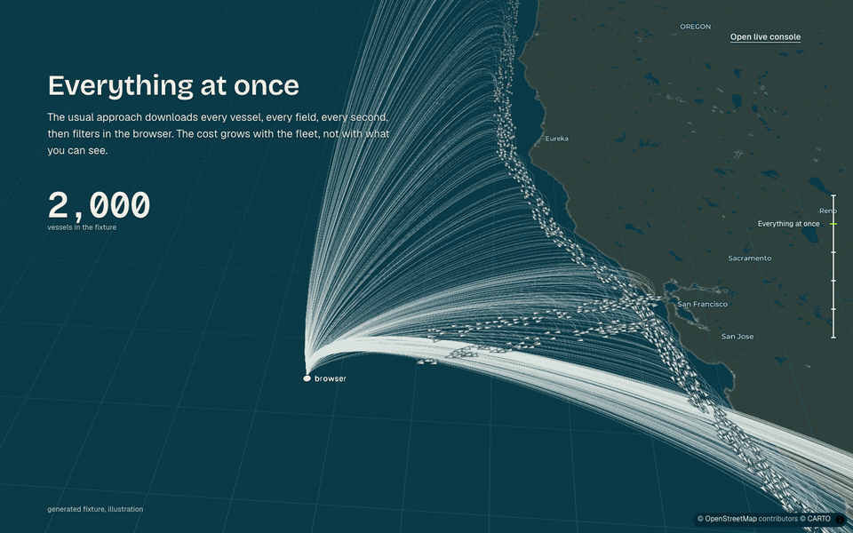
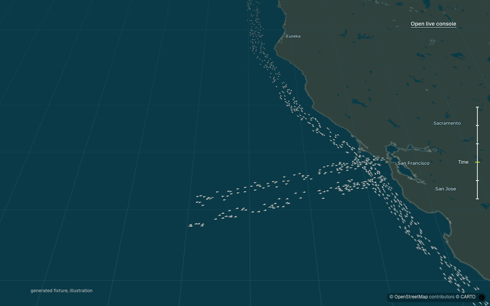
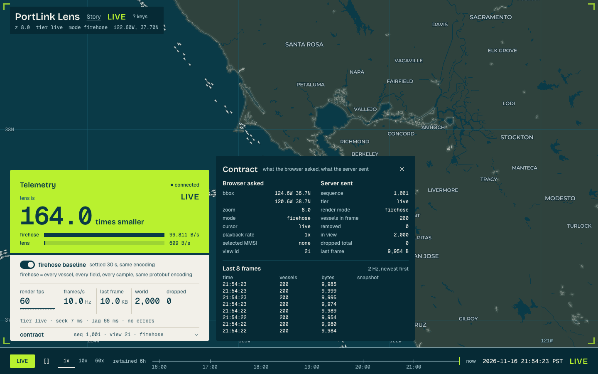
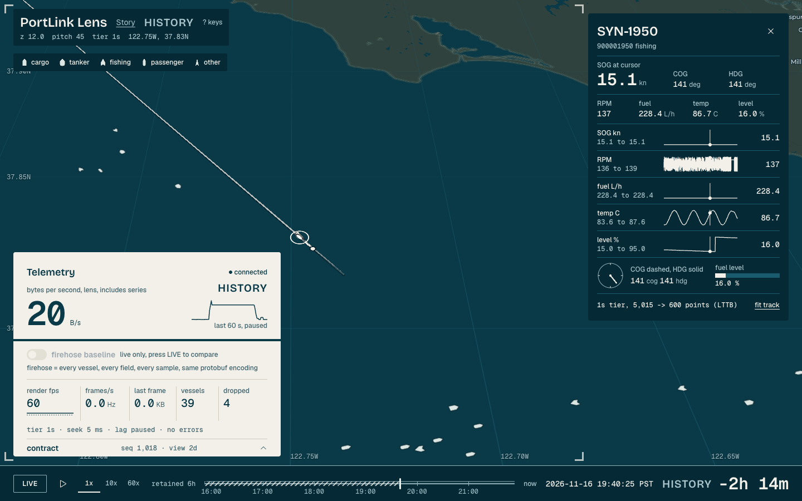
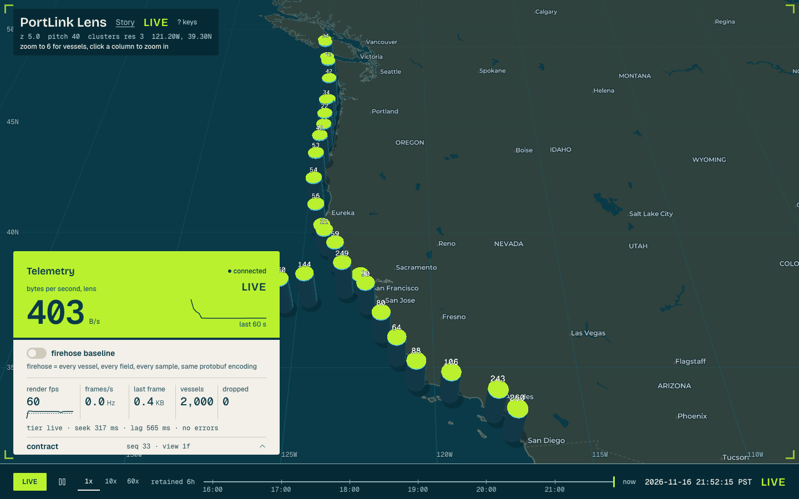
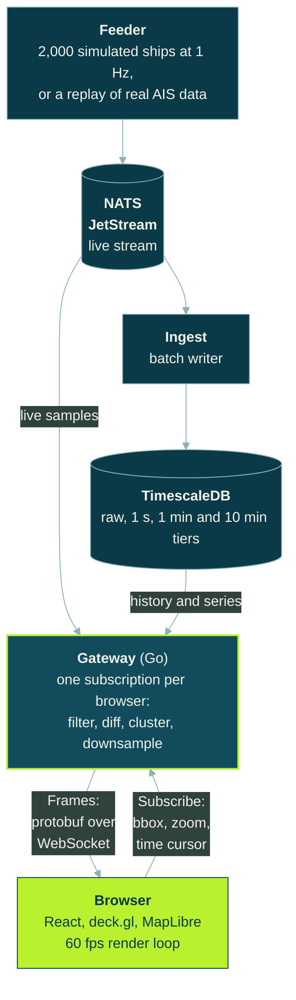
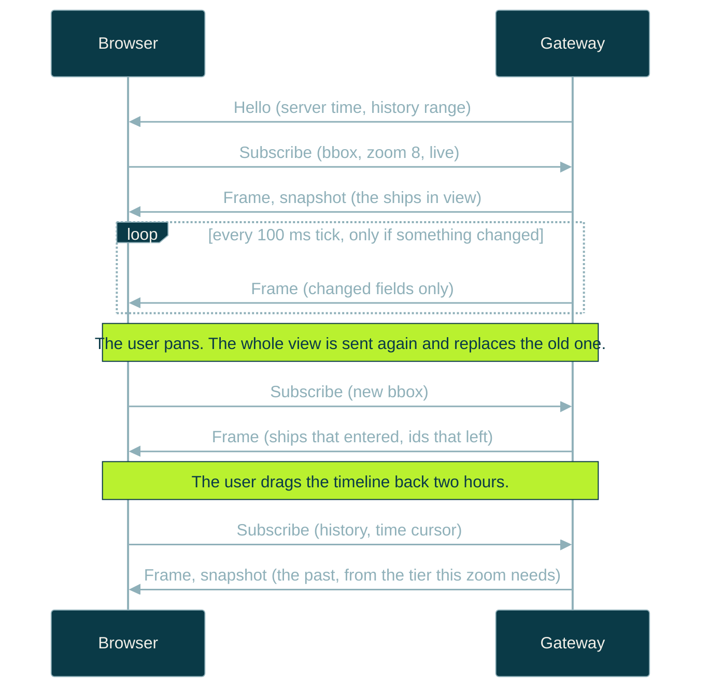

<div align="center">

# PortLink Lens

### The browser tells the server what it can see. The server streams only that.

Viewport aware telemetry streaming for a fleet of 2,000 vessels, drawn at 60 fps,<br/>
with the cost of every frame measured on screen.

[](https://github.com/Jenil133/PortLink/actions/workflows/ci.yml)


[The idea](#the-idea) · [See it](#see-it) · [How it works](#how-it-works) · [Evidence](#evidence) · [Run it](#run-it)

<br/>



<sub>The opening story, scene 3: only the ships inside the lens keep streaming. Illustration data.</sub>

</div>

<br/>

<table>
<tr>
<td align="center" width="25%"><h2>164×</h2>less data than sending everything, at zoom 8</td>
<td align="center" width="25%"><h2>60 fps</h2>with 2,000 ships on the client</td>
<td align="center" width="25%"><h2>0 drops</h2>across 50 clients under load</td>
<td align="center" width="25%"><h2>6 hours</h2>of history on one scrubber</td>
</tr>
</table>

<sub>Every number here is measured, and <a href="#evidence">Evidence</a> shows how to reproduce each one. The fleet is simulated.</sub>

## The idea

Most fleet dashboards send **every ship, every field, every second**, and let the browser filter. Zoom into one bay and you still download the whole fleet. The cost grows with the fleet, not with what is on screen.

PortLink Lens turns that around. Each time you pan, zoom or move the timeline, the browser sends one small message: its bounding box, zoom level, time cursor and selected ship. The server keeps that as a standing subscription and sends only the ships inside it, only the fields that changed, at the detail that zoom can show.

> Front end performance at this scale is a backend contract problem. This project makes that contract visible: what the browser asked for, what the server sent, and what it cost.

## See it

### Back through time, then down to one ship

History is the same request with a time cursor. Move it and the server sends the past, in one minute buckets from far out and one second buckets up close. Select a ship and five instruments arrive with it, each a six hour series reduced to 600 points.

<div align="center">


<sub>The opening story, scenes 4 and 5. Illustration data.</sub>
</div>

### The live console

<table>
<tr>
<td width="50%"></td>
<td width="50%"></td>
</tr>
<tr>
<td><b>The proof.</b> One switch turns off every optimization. The card shows both rates and the ratio, and the contract panel shows each request and frame.</td>
<td><b>History is the same request with a time cursor.</b> Drag back up to 6 hours. A selected ship brings its track and five charts, cut from 5,015 points to 600.</td>
</tr>
<tr>
<td></td>
<td></td>
</tr>
<tr>
<td><b>Zoomed out, ships become counts.</b> Below zoom 6 the server sends clusters. All 2,000 ships cost about 400 bytes per second here.</td>
<td><b>A scroll driven story explains the idea first.</b> Six 3D scenes, then the same canvas becomes the live console with no reload.</td>
</tr>
</table>

## How it works



The contract is one request and one stream, defined in [`lens.proto`](proto/lens/v1/lens.proto):



### What the server is allowed to skip

| Technique | What it saves | Where |
|---|---|---|
| **Viewport filter** | Ships outside the box are never sent | [`world.go`](server/internal/gateway/world.go), [`spatial/`](server/internal/spatial) |
| **Field deltas** | An update carries only the fields that changed | [`delta.go`](server/internal/gateway/delta.go) |
| **Zoom aware thresholds** | A move too small to see at this zoom is not sent | [`delta.go`](server/internal/gateway/delta.go) |
| **Clusters** | Below zoom 6, counts per H3 cell replace ships | [`cluster.go`](server/internal/gateway/cluster.go) |
| **History tiers** | 10 minute, 1 minute or 1 second buckets, chosen by zoom | [`tier.go`](server/internal/gateway/tier.go), [`002_aggregates.sql`](db/migrations/002_aggregates.sql) |
| **LTTB downsampling** | A 6 hour series becomes 600 points that keep its shape | [`lttb/`](server/internal/lttb), [`series.go`](server/internal/gateway/series.go) |
| **Conflation** | A slow client gets the newest state, never a growing queue | [`client.go`](server/internal/gateway/client.go) |

On the browser side, ship positions live in typed arrays outside React ([`vessels.ts`](web/src/state/vessels.ts)). One render loop glides them between updates ([`engine.ts`](web/src/scene/engine.ts)), and the panels sample their numbers twice a second.

## Evidence

Measured on an Apple M5 laptop with the default simulated fleet: 2,000 ships at 1 Hz. The stack ran in Docker, and browser numbers come from Chrome.

| Claim | Measured | How to check it |
|---|---|---|
| The lens sends far less than the firehose | **609 B/s** against **99,827 B/s** at zoom 8 with a still view: **164×** | Open the console, wait 45 s, press `F`, wait 30 s. The card shows both rates |
| It holds under many clients | 50 clients: **171 B/s** each on lens, **99,899 B/s** each on firehose, **0 dropped** | The load generator below |
| The map stays smooth | **60 fps** with 1,168 ships in view, and with all 2,000 during firehose | The `render fps` cell, measured in the browser |
| The story stays smooth | **60 fps** through all six scenes on a first load, no frame over 50 ms | Scroll the opening page |
| Seeking into history is fast | **under 20 ms** from request to first frame | The `seek` value in the card footer |
| A slow client never falls behind | With a 300 ms delay per frame: **38 ticks dropped** in 6 s, positions still current | Add `?slow_ms=300` to the console URL |
| Clusters are cheap | All 2,000 ships at zoom 5 for about **400 B/s** | Zoom out below 6 |
| It is tested | **81** Go tests with the race detector and **22** web tests | `make test`, and the CI badge above |

The ratio depends on the view. It is highest when the view is still, and lower while panning, because new ships keep entering. The load generator's clients sit at random zooms from 7 to 12 and pan every 2 seconds:

```console
$ cd server && go run ./cmd/loadgen -clients 50 -warmup 30s -duration 30s
clients  mode       seconds    total B/s B/s per client frames/s/client max dropped  vessels
50       lens            30         8534            171             1.2           0     2000

$ cd server && go run ./cmd/loadgen -clients 50 -warmup 30s -duration 30s -firehose
clients  mode       seconds    total B/s B/s per client frames/s/client max dropped  vessels
50       firehose        30      4994962          99899            10.0           0     2000
```

The firehose is a fair baseline: the same ships, the same protobuf encoding and the same connection, with the filter, the deltas and the clusters turned off.

## Run it

You need Docker and `make`. The test and load commands also need Go 1.26 and Node 22.

```bash
git clone https://github.com/Jenil133/PortLink.git
cd PortLink
cp .env.example .env
make backfill-docker   # load 6 hours of history, about a minute
make up                # build and start everything
```

Open **http://localhost:8088** for the story, or **http://localhost:8088/console** to go straight to the map.

| Command | What it does |
|---|---|
| `make up` / `make down` | Start or stop the whole stack |
| `make backfill-docker` | Publish the previous 6 hours, then build the history tiers |
| `make test` | Go tests, then the web type check and tests |
| `make loadgen` | 50 simulated clients for 30 seconds |
| `make fetch-ais` | Download one day of real US AIS data for replay |
| `make web` | Front end dev server on port 5173 |

**Keys in the console:** `L` live · `Space` pause · `F` firehose · `C` contract panel · `Esc` close · `?` all shortcuts

## Layout

| Path | What is in it |
|---|---|
| [`proto/`](proto/lens/v1/lens.proto) | The wire contract, one protobuf file |
| [`server/cmd/`](server/cmd) | `feeder`, `ingest`, `gateway` and `loadgen` |
| [`server/internal/gateway/`](server/internal/gateway) | Subscriptions, diffing, clusters, tiers, series, back pressure |
| [`db/migrations/`](db/migrations) | Hypertable, continuous aggregates, retention |
| [`web/src/scene/`](web/src/scene) | The deck.gl scene: story layers, console layers, render loop |
| [`web/src/net/`](web/src/net) | WebSocket client and the measurements |
| [`web/src/ui/`](web/src/ui) | Story copy, instrument card, timeline, ship panel |

## Built with

[Go](https://go.dev) · [NATS JetStream](https://docs.nats.io/nats-concepts/jetstream) · [TimescaleDB](https://docs.timescale.com) · [Protocol Buffers](https://protobuf.dev) with [Buf](https://buf.build) · [H3](https://h3geo.org) · [React](https://react.dev) · [deck.gl](https://deck.gl) · [MapLibre GL](https://maplibre.org) · [Zustand](https://zustand.docs.pmnd.rs) · [Vite](https://vite.dev) · basemap by [CARTO](https://carto.com/basemaps) and [OpenStreetMap](https://www.openstreetmap.org/copyright) contributors · downsampling after Sveinn Steinarsson's [Largest Triangle Three Buckets](https://skemman.is/handle/1946/15343)
